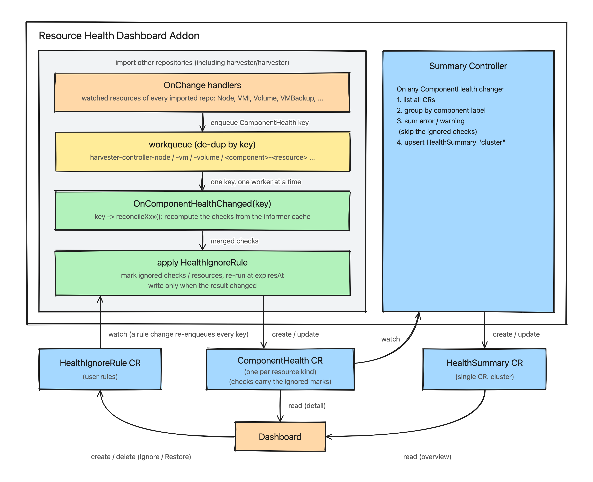
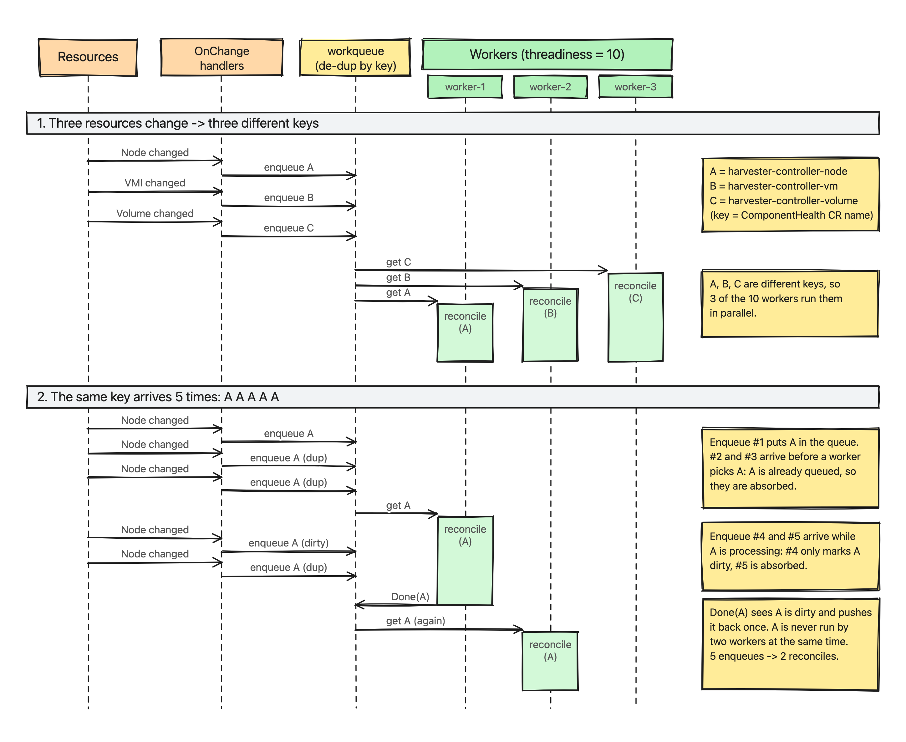
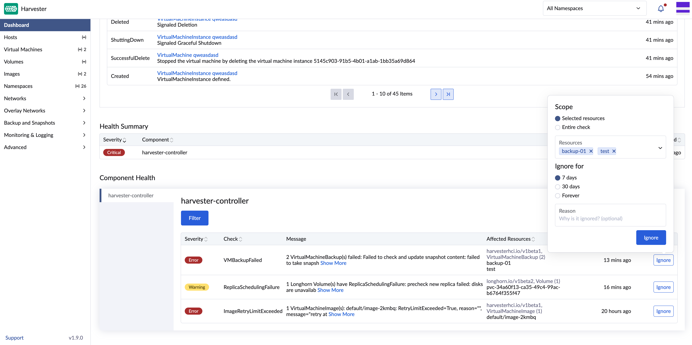
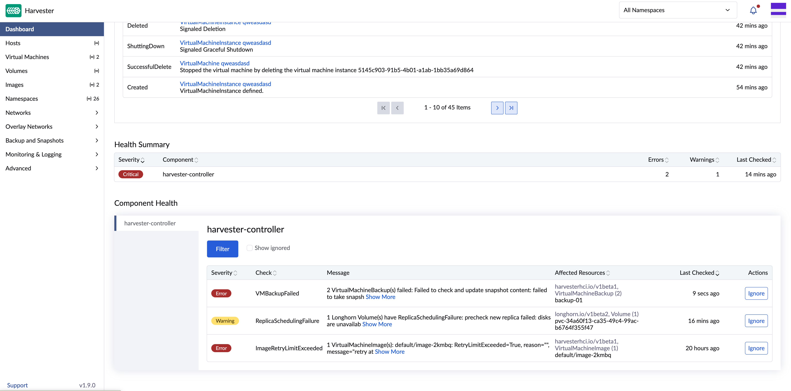
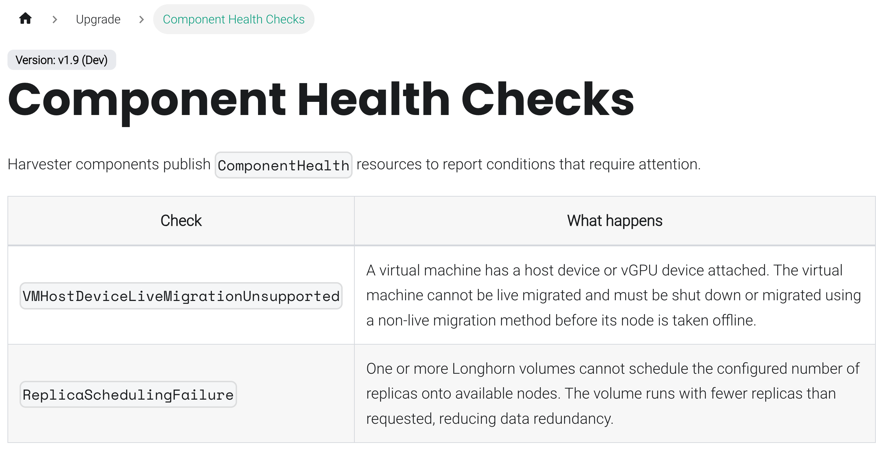
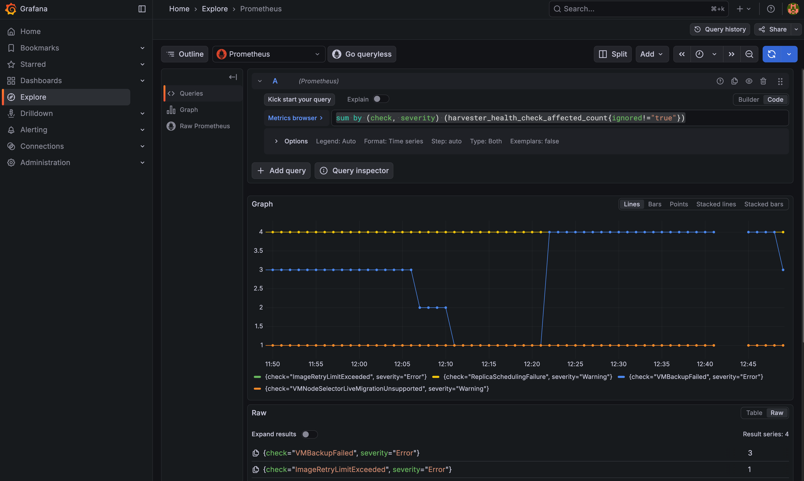
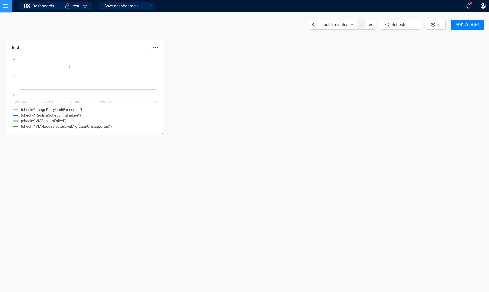

# Resource Health Dashboard

## Summary

Harvester currently lacks a unified way to inspect the health of its internal components or show the general status of the system. When users report issues, the investigation requires manually checking resources across multiple controllers. This enhancement introduces a framework for proactive health and status reporting: each component maintains one or more `ComponentHealth` CRs describing its current check results, and a summary controller aggregates all component CRs into a single `HealthSummary` CR. The dashboard then reads the summary for the overview and fetches per-component detail from the individual `ComponentHealth` CRs when needed. Because some warnings or errors are expected or harmless in a given cluster, users can also ignore a check, or some of its affected resources, with a `HealthIgnoreRule` CR, so the dashboard and the summary only show what needs attention.

### Related Issues

https://github.com/harvester/harvester/issues/8436

## Motivation

When a user-reported issue is vague, there is no single place to determine the root cause. Engineers must inspect each component individually. Some problems, such as a missing required resource or a misconfigured VM, are only found when someone happens to look, rather than surfaced proactively.

### Goals

- Provide a `ComponentHealth` CRD so each component can report its own health checks.
- Provide a `HealthSummary` CRD that aggregates all component health statuses into a single resource.
- Provide a `HealthIgnoreRule` CRD so users can ignore the checks (or some affected resources of a check) that are not important for them, without losing the check results.

### Non-goals

- Replacing SUSE Observability or rancher-monitoring. Those tools focus on metrics and observability such as CPU, memory, and service topology. This framework only reports the state and configuration of the resources Harvester itself uses.
- Checking workloads or resources that are unrelated to Harvester.
- Admission webhook validation for the resources this framework checks. That is a separate, independent concern and out of scope for this HEP.

## Introduction

This enhancement introduces three CRDs:

**ComponentHealth CRD**

Each component runs one or more reconcile loops that evaluate its own health rules and write the results to the `ComponentHealth` CR(s) it owns (one per resource kind it checks, see [ComponentHealth](#componenthealth) below). This makes health status visible rather than discoverable only when someone happens to look.

**HealthSummary CRD**

A summary controller watches all `ComponentHealth` CRs and maintains a single `HealthSummary` CR, grouping CRs by their `health.harvesterhci.io/component` label so a component that owns several CRs still contributes one entry. The dashboard reads only the summary CR for the overview. When a user drills down into a component, the Harvester UI extension lists that component's `ComponentHealth` CRs by label selector and aggregates them client-side, since a component's detail is no longer guaranteed to be a single CR.

**HealthIgnoreRule CRD**

A `HealthIgnoreRule` tells the component health controller to mark a check of a `ComponentHealth` (or only some of its affected resources) as ignored, optionally until an expiry time. The check is kept in the `ComponentHealth` status with an `ignored` mark instead of being removed, and ignored checks no longer count in the `HealthSummary`. The dashboard hides them by default. Users create or delete these rules, for example from the dashboard.

#### Architecture Diagram



The whole framework is a standalone addon. The addon imports the CRDs and controller packages of the other repositories (`harvester/harvester` included), and implements the `OnChange` handlers for their watched resources itself. The `Component Health Controller` in the addon follows the same enqueue / de-dup / reconcile flow for the `ComponentHealth` CRs it owns. The `Summary Controller` exists once in the addon.

The ignore rules are applied by the `Component Health Controller` only, right after the checks of a `ComponentHealth` are recomputed and before they are written. `ComponentHealth.status` has a single writer, the controller, so the dashboard never edits it: it only creates or deletes `HealthIgnoreRule` CRs, and the controller derives the ignored marks from the current checks and rules on every reconcile. The `Summary Controller` skips the ignored checks, so the overview and the detail always agree.

Within each `Component Health Controller`, every `OnChange` handler of a watched resource does not compute anything itself. It only enqueues the key of the `ComponentHealth` CR that owns that resource kind (for example `harvester-controller-node`) into the controller's workqueue. The workqueue de-duplicates identical keys, so a burst of events (e.g. many Node or VMI updates) collapses into a single reconcile of the corresponding `ComponentHealth` CR.

## Proposal

### User Stories

#### Story 1

As a Harvester administrator, I open the dashboard and immediately see that the upgrade component is reporting an error because a default StorageClass is missing. I can click through to see which resource is affected and take action before attempting an upgrade.

#### Story 2

As an engineer debugging a customer issue, I run `kubectl get componenthealths --all-namespaces` and instantly see which components have active warnings or errors, without needing to inspect each controller's logs individually.

#### Story 3

As a VM operator, I see a warning on the dashboard that three of my VMs cannot be live migrated because they use host devices or vGPU devices. I can resolve the issue before scheduling a maintenance window.

#### Story 4

As a Harvester administrator, I know that a Longhorn volume of a test VM is expected to have a replica scheduling warning. I click **Ignore** on that volume in the dashboard, choose how long to ignore it, and the warning no longer counts in the overview. Other volumes that hit the same warning later are still reported, and I can restore the ignored volume at any time.

### API Changes

Three new CRDs are introduced under the new `health.harvesterhci.io/v1beta1` API group, owned by the resource health addon. All of them are cluster-scoped.

#### ComponentHealth

A logical component (e.g. `harvester-controller`) does not own a single `ComponentHealth` CR. Instead, it owns one CR per resource kind it reports on. All CRs belonging to the same logical component share the label `health.harvesterhci.io/component: <component-name>`.

CR names follow the convention `<component-name>-<resource-name>`, e.g. `harvester-controller-node`, `harvester-controller-vm`, `harvester-controller-volume`.

Splitting the CR per resource (instead of one CR per component) means each reconcile loop within a component only ever patches the status of the CR it owns, avoiding update conflicts that would occur if multiple independent reconcile loops (e.g. a node check and a VM check) raced to patch the same object's status subresource.

```yaml
apiVersion: v1
kind: List
items:
- apiVersion: health.harvesterhci.io/v1beta1
  kind: ComponentHealth
  metadata:
    name: harvester-controller-node
    labels:
      health.harvesterhci.io/component: harvester-controller
  status:
    lastUpdatedAt: "2026-09-22T02:30:04Z"
    checks:
      NodeCordoned:
        severity: Info
        message: "1 Node(s) are cordoned"
        affectedCount: 1
        affectedResources:
          apiVersion: v1
          kind: Node
          names:
            harvester2: {}
- apiVersion: health.harvesterhci.io/v1beta1
  kind: ComponentHealth
  metadata:
    name: harvester-controller-vm
    labels:
      health.harvesterhci.io/component: harvester-controller
  status:
    lastUpdatedAt: "2026-09-17T05:49:20Z"
    checks:
      VMHostDeviceLiveMigrationUnsupported:
        severity: Warning
        message: "1 VM(s) cannot be live migrated: PCIe, USB or vGPU devices are attached"
        affectedCount: 1
        affectedResources:
          apiVersion: kubevirt.io/v1
          kind: VirtualMachine
          names:
            default/test: {}
```

`checks` is a map keyed by `reason`, so a controller can update or delete a single check result when a resource changes or when a warning returns to normal. `affectedResources.names` is a map keyed by resource name. It uses `namespace/name` for namespaced resources and bare `name` for cluster-scoped resources. The map value only carries the ignore marks of the resource (`ignored`, `ignoredBy`), which are empty when the resource is not ignored.

`affectedResources` is a pointer field and may be absent for checks that do not relate to a specific resource kind.

When a `HealthIgnoreRule` matches, the controller marks the check instead of removing it. `ignored` and `ignoredBy` (the name of the rule) are set on the single affected resource that the rule lists. A check is marked as a whole once every affected resource of it is ignored, or once a rule without `resources` matches it. The raw facts such as `affectedCount` are never changed:

```yaml
checks:
  ReplicaSchedulingFailure:
    severity: Warning
    message: "2 Longhorn Volume(s) have ReplicaSchedulingFailure: replica scheduling failed"
    affectedCount: 2
    affectedResources:
      apiVersion: longhorn.io/v1beta2
      kind: Volume
      names:
        pvc-aaa:
          ignored: true
          ignoredBy: ignore-volume-pvc-aaa
        pvc-bbb: {}
```

`lastUpdatedAt` is only updated when the `checks` of that CR actually change (including the initial creation), not on every reconcile. It therefore tells readers when the current status was last updated, not when it was last evaluated. A check is expected to contain one `affectedResources` group because affected resources for the same reason are normally the same `apiVersion` and `kind`.

Because a single logical component can now be represented by several CRs, `kubectl get componenthealths -A` naturally lists one row per resource kind rather than one row per component:

```
NAME                                        AGE
harvester-controller-node                   16h
harvester-controller-schedulevmbackup       4d19h
harvester-controller-vm                     5d21h
harvester-controller-vmbackup               4d19h
harvester-controller-volume                 5d21h
```

#### HealthSummary

There is exactly one `HealthSummary` CR, named `cluster`, maintained by the summary controller.

```yaml
apiVersion: health.harvesterhci.io/v1beta1
kind: HealthSummary
metadata:
  name: cluster
status:
  lastUpdatedAt: "2026-05-15T10:00:00Z"
  components:
    upgrade-controller:
      errorCount: 1
      warningCount: 0
    harvester-controller:
      errorCount: 0
      warningCount: 1
```

`components` is a map keyed by the `health.harvesterhci.io/component` label value, not by CR name. The summary controller reconciles on every `ComponentHealth` change, lists all `ComponentHealth` CRs, groups them by that label, and sums the error/warning counts of every check across all CRs sharing the same component label into a single entry. This lets a component add, remove, or rename its per-resource CRs without changing the structure of the summary. The checks that are ignored (`ignored: true`) are skipped, so only the checks that need attention count. The summary CR does not embed the check details from each CR. Its only role is to give the dashboard a single read to determine per-component error and warning counts. Detail is always fetched from the individual `ComponentHealth` CRs.

Because the detail view for one logical component may now require reading multiple `ComponentHealth` CRs, the Harvester UI extension is responsible for a basic aggregation step on drill-down: it lists CRs with a `health.harvesterhci.io/component=<name>` label selector and merges their `checks` maps for display. The API server performs no aggregation beyond the cluster-wide `HealthSummary` counts.

#### HealthIgnoreRule

A rule is matched with its spec only; labels are not used by the controller.

```yaml
apiVersion: health.harvesterhci.io/v1beta1
kind: HealthIgnoreRule
metadata:
  name: ignore-volume-pvc-aaa
spec:
  componentHealth: harvester-controller-volume   # name of the ComponentHealth CR
  checkKey: ReplicaSchedulingFailure             # key in status.checks
  resources:                                     # optional, names in status.checks[].affectedResources.names
  - pvc-aaa
  expiresAt: "2026-11-18T10:00:00Z"              # optional, the rule never expires when it is not set
  reason: "test volume, expected"                # optional
```

- `componentHealth` and `checkKey` select the check. `resources` limits the rule to some of its affected resources, and the entire check is ignored when it is empty. A rule that lists resources does not swallow the resources that hit the same check later.
- A rule never expires unless `expiresAt` is set. An expired rule has no effect, and the controller reconciles again at the expiry time so the check is reported again without any other event.

### Go Types

```go
// ComponentHealth

type ComponentHealthStatus struct {
    LastUpdatedAt metav1.Time            `json:"lastUpdatedAt"`
    Checks        map[string]CheckResult `json:"checks,omitempty"`
}

type CheckResult struct {
    Severity          Severity           `json:"severity"`
    Message           string             `json:"message"`
    AffectedCount     int                `json:"affectedCount,omitempty"`
    AffectedResources *AffectedResources `json:"affectedResources,omitempty"`
    // Ignored is true when the whole check is ignored, it does not count in the HealthSummary then.
    Ignored   bool   `json:"ignored,omitempty"`
    // IgnoredBy is the name of the HealthIgnoreRule that ignores the check.
    IgnoredBy string `json:"ignoredBy,omitempty"`
}

type AffectedResources struct {
    APIVersion string                            `json:"apiVersion"`
    Kind       string                            `json:"kind"`
    Names      map[string]AffectedResourceDetail `json:"names,omitempty"`
}

type AffectedResourceDetail struct {
    // Ignored is true when this resource is ignored by a HealthIgnoreRule.
    Ignored   bool   `json:"ignored,omitempty"`
    IgnoredBy string `json:"ignoredBy,omitempty"`
}

type Severity string

const (
    SeverityError   Severity = "Error"
    SeverityWarning Severity = "Warning"
    SeverityInfo    Severity = "Info"

    // LabelKeyComponent groups all ComponentHealth CRs belonging to the same logical component.
    LabelKeyComponent = "health.harvesterhci.io/component"
)

// HealthSummary

type HealthSummaryStatus struct {
    LastUpdatedAt metav1.Time                  `json:"lastUpdatedAt"`
    Components    map[string]ComponentSummary `json:"components,omitempty"`
}

type ComponentSummary struct {
    ErrorCount   int    `json:"errorCount"`
    WarningCount int    `json:"warningCount"`
}

// HealthIgnoreRule

type HealthIgnoreRuleSpec struct {
    ComponentHealth string       `json:"componentHealth"`
    CheckKey        string       `json:"checkKey"`
    Resources       []string     `json:"resources,omitempty"`
    ExpiresAt       *metav1.Time `json:"expiresAt,omitempty"`
    Reason          string       `json:"reason,omitempty"`
}
```

All the CRDs live in the `health.harvesterhci.io/v1beta1` API group. The Go types are defined in the addon (`pkg/apis/health.harvesterhci.io/v1beta1`), and the CRD manifests are generated from them into the addon chart's `crds` directory.

## Design

### Implementation Overview

#### Check Logic Is Component-owned

There are many kinds of health signal, but they fall into three broad categories:

- **Surface resource status** — expose a status that already exists on a resource but is hard to find, such as a missing required resource or a failed operation. For example, when a required resource is deleted (e.g. the default StorageClass), or when a `ManagedChart` reports a failure in its status because one of its resources is gone. The health controller reads the status or checks that the resource still exists, and reports an `Error` or `Warning`.
- **Resource configuration that blocks expected operations** — a resource exists but its current configuration prevents a normal operation from succeeding (e.g. a VM has a `nodeSelector`, host devices or vGPU devices and cannot be live-migrated). The health controller detects this condition and tells the user before the operation is attempted.
- **Info report** — useful basic information that is expected or benign, reported with `Severity: Info`, for example which Node is cordoned (`node.spec.unschedulable` is `true`), whether a VM live migration is running, or the current phase of a `VirtualMachineBackup`. A component may also use `Warning`/`Error` if it judges the state worth flagging. No new mechanism is needed: these are reported the same way as any other check. This keeps the framework useful as a general status/observability surface for a component, not just an anomaly detector.

Each component decides its own check logic. There is no shared interface or abstraction that every component's checks must implement.

#### Component Health Controller

The sequence below shows how `OnChange` enqueues are de-duplicated and processed by the workers (default `threadiness` is 10, so different keys run in parallel, while the same key is never run by two workers at the same time):



Each component's health controller owns one `Handler`. The resource `OnChange` callbacks do not compute checks themselves; they only enqueue the key of the `ComponentHealth` CR that owns that resource kind. The actual check is done by a single `OnChange` handler registered on `ComponentHealth` itself, which dispatches by key to the matching `reconcileXxx()` function:

1. A watched resource (Node, VMI, Volume, VMBackup, ScheduleVMBackup) changes and its `OnChange` callback enqueues the fixed `ComponentHealth` key for that kind (e.g. `harvester-controller-node`).
2. The controller workqueue de-duplicates by key, so any number of resource events that arrive before the key is processed collapse into one reconcile, and one key is never processed by two workers at the same time.
3. `OnComponentHealthChanged(key)` maps the key to its `reconcileXxx()` function, which lists the resources from the informer cache, recomputes all checks for that kind, and persists them with `updateComponentHealthChecks`.

```go
const (
    componentName             = "harvester-controller"
    nodeComponentHealthName   = "harvester-controller-node"
    vmComponentHealthName     = "harvester-controller-vm"
    volumeComponentHealthName = "harvester-controller-volume"
    // ... vmbackup, schedulevmbackup
)

func Register(ctx context.Context, management *config.Management, _ config.Options) error {
    componentHealths := management.HarvesterFactory.Harvesterhci().V1beta1().ComponentHealth()
    nodes := management.CoreFactory.Core().V1().Node()
    vmis := management.VirtFactory.Kubevirt().V1().VirtualMachineInstance()
    volumes := management.LonghornFactory.Longhorn().V1beta2().Volume()

    h := &Handler{ /* componentHealthController, resource caches, healthCachesSynced, ... */ }

    // the only place checks are computed: dispatch by ComponentHealth key
    componentHealths.OnChange(ctx, "component-health-reconcile", h.OnComponentHealthChanged)

    // resource handlers only enqueue
    nodes.OnChange(ctx, nodeControllerName, h.OnNodeChanged)
    vmis.OnChange(ctx, vmiControllerName, h.OnVMIChanged)
    volumes.OnChange(ctx, volumeControllerName, h.OnVolumeChanged)

    // seed every key once caches are synced so checks exist even when no resource changes
    go h.enqueueInitialHealth(ctx)
    return nil
}

func (h *Handler) OnNodeChanged(_ string, node *corev1.Node) (*corev1.Node, error) {
    h.componentHealthController.Enqueue(nodeComponentHealthName)
    return node, nil
}

func (h *Handler) OnComponentHealthChanged(key string, health *harvesterv1.ComponentHealth) (*harvesterv1.ComponentHealth, error) {
    var reconcile func() error
    switch key {
    case nodeComponentHealthName:
        reconcile = h.reconcileNodes
    case vmComponentHealthName:
        reconcile = h.reconcileVMI
    case volumeComponentHealthName:
        reconcile = h.reconcileVolumes
    // ... vmbackup, schedulevmbackup
    default:
        return health, nil // not owned by this controller
    }
    // return an error (requeue) until all informer caches are synced
    return health, reconcile()
}
```

Because the key is the only thing carried through the queue, the reconcile always reads the latest state from the informer cache rather than acting on the individual event. This makes the result idempotent and independent of event order or count.

`updateComponentHealthChecks(componentHealthName, checks, ownedKeys)` is the shared helper every `reconcileXxx()` calls to persist its result: it gets-or-creates the named CR, replaces only the entries in `ownedKeys` (so one check function never clobbers another check function's keys within the same CR), sets the `health.harvesterhci.io/component` label, and skips the write entirely if the resulting `checks` are unchanged:

```go
func (h *Handler) updateComponentHealthChecks(componentHealthName string, checks map[string]harvesterv1.CheckResult, ownedKeys []string) error {
    // get-or-create the CR named componentHealthName
    // remove any existing entries whose key is in ownedKeys, then merge in checks
    // if the merged checks equal the existing ones, return without writing
    // otherwise update status.checks and status.lastUpdatedAt, setting the component label
}
```

The no-op-when-unchanged rule matters because writing a `ComponentHealth` CR triggers `OnComponentHealthChanged` again for the same key. The second pass finds nothing to change and stops, so the loop converges instead of re-writing forever. This is also why `lastUpdatedAt` only moves when the checks change: it records when the current status was last updated, not when it was last evaluated.

Because each resource kind's checks live in a dedicated CR, and each key is processed by one worker at a time, concurrent reconciles across resource kinds cannot race on the same object's status. This is the concurrency motivation for splitting `ComponentHealth` per resource described above.

Components from other repositories use the same pattern: the addon imports their CRDs and controller packages, registers `OnChange` callbacks that enqueue the component's own `ComponentHealth` key, and persists results through the same get-or-create / no-op-when-unchanged logic. The `Summary Controller` is not duplicated.

#### Summary Controller

A single summary controller in the addon watches all `ComponentHealth` CRs. On any change:

1. It reads all `ComponentHealth` CRs.
2. It groups them by the `health.harvesterhci.io/component` label (falling back to the CR name if the label is absent) and sums the error/warning counts of every check across all CRs in the same group.
3. It upserts the `HealthSummary` CR named `cluster`, creating it if absent.

#### Ignoring Checks

Some warnings or errors are expected or harmless in a given cluster. The framework lets users ignore them without changing the check logic of the components.

**Where the decision is stored.** `ComponentHealth.status` is recomputed by the controller on every reconcile, so an ignore flag written into it by the dashboard would be overwritten by the next reconcile. The decision is therefore a separate `HealthIgnoreRule` CR, and the controller is the only writer of the ignored marks. This also keeps the `HealthSummary`, the dashboard and any other consumer consistent, because the marks are computed once in the controller instead of being filtered in each client.

**How the rules are applied.** `updateComponentHealthChecks` merges the checks of one reconcile with the checks kept from the other check functions of the same `ComponentHealth`. The rules are applied on this merged result right before it is compared with the existing `checks` and written:

```go
rules := h.listIgnoreRules(componentHealthName)   // informer cache, filtered by spec.componentHealth
checks, nextExpiry := applyIgnoreRules(mergedChecks, rules, time.Now())
if nextExpiry != nil {
    h.componentHealthController.EnqueueAfter(componentHealthName, time.Until(*nextExpiry))
}
```

- The marks are always derived from scratch: `applyIgnoreRules` clears the marks of the existing checks first and works on a copy, so a deleted or expired rule un-ignores the check, and the checks kept from other check functions are marked too.
- The result only depends on the checks, the rules and the current time compared with `expiresAt`. No timestamp such as `ignoredAt` is written, so the "skip the write when unchanged" rule still makes the reconcile converge.
- A change of any `HealthIgnoreRule` (including a deletion, which is seen as a nil object, or a rule that moves to another `ComponentHealth`) enqueues every `ComponentHealth` key. There are only a few keys and the workqueue de-duplicates them, so the handler does not need to know which `ComponentHealth` is affected.
- The rules are listed from the informer cache and filtered by `spec.componentHealth` in memory. The number of rules is small, so no index or label selector is needed.

**Dashboard.** The overview counts and the drill-down view hide the ignored checks by default. A **Show ignored** toggle shows them again. Every check has an **Ignore** action with the following choices, and an ignored check or resource has a **Restore** action that deletes the rule:

- Scope: **Entire check**, or **Selected resources**, which is a multi-select of the affected resources that are not ignored yet. The default is to select all of them, so a resource that hits the same check later is still reported.
- Duration: 7 days, 30 days or forever (`expiresAt` is not set).
- An optional reason.



#### UI Extension Aggregation

Because the overview (`HealthSummary`) is already aggregated per component, the dashboard's landing page needs no further work. The drill-down view is where the UI extension performs its own basic aggregation: given a component name, it lists `ComponentHealth` CRs with `health.harvesterhci.io/component=<name>` and merges their `checks` maps before rendering. The ignored checks are hidden unless the user asks for them, and the ignore / restore actions create or delete `HealthIgnoreRule` CRs. This introduces no new backend endpoint; it is a client-side aggregation over the existing `ComponentHealth` list API.

Action Items:

- [ ] Define `health.harvesterhci.io/v1beta1` CRD manifests for `ComponentHealth`, `HealthSummary` and `HealthIgnoreRule`.
- [ ] Implement the summary controller with label-based grouping, skipping the ignored checks.
- [ ] Apply the `HealthIgnoreRule` CRs in the `ComponentHealth` reconcilers, including expiry handling.
- [ ] Implement `ComponentHealth` reconciler(s) per component, starting with: node, VM live migration, volume, VM backup, scheduled VM backup.
- [ ] Add dashboard/UI extension support to read `HealthSummary` for the overview and aggregate per-component `ComponentHealth` CRs for drill-down.
- [ ] Add the **Ignore** / **Restore** actions and the **Show ignored** toggle to the dashboard.



### Test Plan

Covered in individual component pull requests. At minimum each component must provide:

- Unit tests for each check function.
- An integration test that verifies the `ComponentHealth` CR reflects the expected check results when a check condition is introduced and cleared.

For the ignore rules:

- Unit tests of the rule matching: the entire check, selected resources, an unknown resource, an expired rule, the earliest expiry, and stale marks being cleared.
- A test that a second reconcile of ignored checks does not write the `ComponentHealth` again.
- A test that the summary does not count the ignored checks, and that deleting a rule restores the counts.

### Upgrade Strategy

The `HealthSummary` CR is created by the summary controller on first run; no manual bootstrap is required. Existing clusters upgrading to this version will have their `ComponentHealth` CRs created the first time each component's controller reconciles after upgrade. The `HealthIgnoreRule` CRD is applied by the addon on start, and no rule exists until a user creates one, so the behavior of the existing checks does not change. The new `ignored` and `ignoredBy` fields are optional, and the ones missing from older `ComponentHealth` CRs are treated as not ignored.

## Notes

### Troubleshooting

Because check reasons are pre-defined keys, we can document each one on the docs website and tell users what to do when it appears.



### Addon Components

This framework is implemented as an addon.

**Why an addon.** Health reporting is an observability feature, and it should not affect the core business logic of Harvester. As an addon, the `ComponentHealth` reconcilers, the summary controller and the ignore rules live outside the core controllers. Nothing in the core path depends on them, so a bug or extra load in the health checks does not affect the core controllers.

**Trade-off we accept.** The addon imports the CRDs and controller packages of the other repositories (`harvester/harvester` included) and implements the `OnChange` handlers for their watched resources itself. That means:

- The addon has to import multiple repositories.
- When a check depends on logic in the original repository, a change there may require a corresponding change in the addon.
- Checks need to be reviewed together with their source component so they do not drift or get missed.

We consider this cost acceptable in exchange for keeping the health framework isolated from the core.

**Alternative considered.** Each component could own its check logic in its own repository and import the shared API types from `harvester/harvester`, so each repository only maintains its own scope. This avoids the drift described above, but puts the health code inside the core controllers, which is what we want to avoid.

### Future Work: Health History

This is not part of this HEP. The two screenshots below show what could be achieved in the future by exporting the `ComponentHealth` checks as metrics, so users can see the health history of each check over time.

Rancher Monitoring (Grafana Explore):



SUSE Observability (dashboard):


